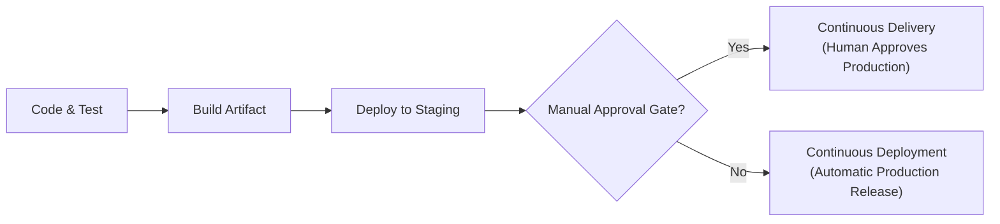

# AutoDeploy: DevOps & CI/CD Technical Interview Guide 🎯

This document is an exhaustive interview preparation handbook based on the **AutoDeploy** project. It is structured to help you confidently explain the architecture, trade-offs, and failure recovery mechanisms during software engineering and DevOps interviews.

---

## ⏱️ Elevator Pitches

### 60-Second Project Explanation
> "In this project, called **AutoDeploy**, I built an automated, production-grade CI/CD pipeline for a Python/Flask microservice using GitHub Actions, Docker, and Render. 
> Whenever a developer opens a pull request or merges code into the `main` branch, a GitHub Actions workflow automatically checks out the repository, configures the runtime environment, and runs an automated Pytest suite. If all tests pass on a push to `main`, the pipeline automatically builds and validates a lightweight, non-root Docker container image, and triggers an automated deployment to Render Cloud via a secure webhook. 
> This eliminates manual deployment errors, prevents regressions, ensures cross-environment parity, and achieves true continuous deployment."

---

### 2-Minute Technical Deep-Dive
> "The AutoDeploy project addresses three fundamental challenges in modern software delivery: regression prevention, environment inconsistency, and deployment friction.
> 
> First, on the application layer, I developed a lightweight Flask service running behind a production WSGI Gunicorn server. It exposes business endpoints along with `/health` and `/api/info` endpoints for observability and platform health checks.
> 
> Second, for quality assurance, I authored an automated Pytest suite that validates HTTP response codes, response payload schemas, and fallback routes using Flask's test client.
> 
> Third, I built a two-stage GitHub Actions pipeline in `.github/workflows/ci-cd.yml`. The Continuous Integration (CI) stage triggers on both push and pull requests targeting `main`. It sets up Python 3.11 with pip caching and runs tests. If any test fails, the runner halts and blocks the pull request from merging.
> 
> The Continuous Deployment (CD) stage only executes for pushes to `main` after CI succeeds. It spins up a Docker Buildx runner to validate our multi-step `Dockerfile`—which uses `python:3.11-slim`, drops privileges to an unprivileged `appuser` for security, and dynamically reads the `$PORT` environment variable. Finally, it makes an authenticated POST request to Render's Deploy Hook using GitHub repository secrets, triggering a zero-downtime rolling update.
> 
> This project demonstrates the exact patterns tech companies use: automated testing gates, container immutability, least-privilege security, and hands-off delivery."

---

## 📚 15 Core CI/CD & DevOps Concepts Explained

### 1. What is Continuous Integration (CI)?
**Continuous Integration (CI)** is a software engineering practice where developers regularly merge their code modifications into a central shared repository (often multiple times per day). Each integration triggers an automated build and test sequence. 

**Core Purpose**: Find and address bugs early, improve software quality, and reduce the time it takes to validate and release new software updates.

---

### 2. What is Continuous Deployment (CD)?
**Continuous Deployment (CD)** is the practice where every validated change that passes all stages of the production pipeline is automatically released into the production environment without human intervention.

---

### 3. Difference Between Continuous Delivery and Continuous Deployment



| Dimension | Continuous Delivery | Continuous Deployment |
|---|---|---|
| **Production Gate** | **Manual trigger / Human approval** (e.g., Release Manager clicks "Deploy"). | **Fully automated** (no human approval needed). |
| **Pipeline State** | Code is always in a *deployable state*, but releases happen on a business schedule. | Code is released immediately upon passing automated test suites. |
| **Risk Requirement** | Suitable for enterprise compliance, regulated industries, or complex manual audit processes. | Requires rigorous automated testing, observability, and automated rollback mechanisms. |

---

### 4. What is GitHub Actions?
**GitHub Actions** is a continuous integration and continuous delivery (CI/CD) platform natively integrated into GitHub. It allows you to automate build, test, and deployment pipelines directly within your repository using YAML configuration files stored in `.github/workflows/`.

---

### 5. What is a GitHub Actions Workflow?
A **Workflow** is a configurable automated process composed of one or more jobs. Workflows are defined by a YAML file in the `.github/workflows` directory and execute when triggered by an event in your repository (like a push, pull request, or schedule), or manually.

---

### 6. What are Jobs, Steps, and Runners in GitHub Actions?
- **Runner**: The underlying virtual machine or container that runs the workflow. AutoDeploy uses GitHub-hosted `ubuntu-latest` runners.
- **Job**: A set of steps executed on the same runner. Jobs run in parallel by default, but can be configured to run sequentially using dependencies (`needs: [continuous-integration]`).
- **Step**: An individual task within a job. A step can either run a shell command (`run: pytest -v`) or an external action (`uses: actions/checkout@v4`).

---

### 7. What is Docker?
**Docker** is an open-source platform that uses OS-level virtualization to deliver software in packages called **containers**. Containers bundle an application with all of its dependencies, system tools, libraries, and configurations, guaranteeing that the application behaves identically in development, testing, and production.

---

### 8. What is a Dockerfile?
A **Dockerfile** is a text document containing a sequence of instructions and arguments used by the Docker daemon to assemble an automated container image. Key commands include:
- `FROM`: Specifies the parent/base image (`python:3.11-slim`).
- `WORKDIR`: Sets the working directory inside the container (`/app`).
- `COPY`: Copies local files into the container filesystem.
- `RUN`: Executes commands inside the container during build time (e.g., `pip install`).
- `USER`: Drops root privileges to run as a non-root user (`appuser`).
- `EXPOSE`: Documents which network ports the container listens on (`5000`).
- `CMD`: Provides defaults for executing the container at runtime (`gunicorn ...`).

---

### 9. What is the Difference Between a Docker Image and a Docker Container?
- **Docker Image**: An immutable, read-only template or blueprint containing the application code, libraries, dependencies, and file systems. You can think of an image as a class in object-oriented programming.
- **Docker Container**: A runnable, live instance of an image. It has an isolated filesystem, network stack, and execution process, with a thin read-write layer added on top of the underlying image layers. You can think of a container as an object instantiated from a class.

---

### 10. Why is Automated Testing Critical in CI/CD?
In manual deployment workflows, bugs are often discovered in production. Automated testing in CI/CD:
1. **Provides a Quality Gate**: Catches logic regressions and contract violations before code is ever merged.
2. **Enables Confident Refactoring**: Developers can optimize code knowing that tests will immediately highlight unintended side effects.
3. **Saves Engineering Time**: Replaces hours of manual regression checking with automated tests executed in seconds.

---

### 11. How Does the Pipeline Detect and Isolate Failures?
GitHub Actions monitors the exit code of every executed step:
- An exit code of `0` indicates success.
- Any non-zero exit code (e.g., `1` from a failing `pytest` assertion) indicates failure.
When a step fails:
1. GitHub Actions immediately terminates subsequent steps in that job.
2. Marks the job as failed (red `X`).
3. Blocks downstream dependent jobs (the `continuous-deployment` job is skipped because `needs: [continuous-integration]` fails).
4. GitHub marks the Pull Request status check as failed, preventing merges if branch protection rules are active.

---

### 12. How Does the Deployment Process Work?
1. The developer merges a pull request into `main`.
2. The `continuous-integration` job executes and validates all tests.
3. Once CI succeeds, the `continuous-deployment` job triggers.
4. The CD job executes a secure HTTP POST request to Render's Deploy Hook using `secrets.RENDER_DEPLOY_HOOK_URL`.
5. Render receives the webhook, clones the latest commit from `main`, installs production dependencies, and boots the new application using `gunicorn --bind 0.0.0.0:$PORT app:app`.
6. Render runs health probes against `/health`. Once healthy, it redirects live traffic to the new container and terminates the old instance (zero-downtime deployment).

---

### 13. Why Are GitHub Secrets Essential?
**GitHub Secrets** are encrypted environment variables stored within GitHub's infrastructure and masked in runner logs.
- **Why they matter**: Hardcoding credentials (API keys, webhook tokens, passwords) in public or shared repositories leads to credential leaks and security breaches.
- **Best Practice**: Webhook URLs, private keys, and cloud API tokens must always be injected dynamically through `${{ secrets.SECRET_NAME }}`.

---

### 14. What Happens When a Developer Pushes Broken Code?
Let's trace the failure path:
1. Developer pushes code that breaks the `/health` endpoint JSON format.
2. GitHub Actions detects the push and launches the `continuous-integration` runner.
3. Pytest executes `test_health_endpoint_expected_json`.
4. The assertion fails: Pytest outputs an `AssertionError` and exits with code `1`.
5. GitHub Actions marks the step and job as **FAILED**.
6. Because `continuous-deployment` requires `continuous-integration`, the CD job **never runs**.
7. The Render webhook is **never fired**.
8. **Result**: The production environment remains completely unaffected, running the previous healthy revision without downtime. The developer receives an email/notification with the exact failure logs.

---

### 15. Complete Architecture & Execution Flow
```
[Developer] 
    │ (git push)
    ▼
[GitHub Repository]
    │ (Webhook Trigger)
    ▼
[GitHub Actions Runner (Ubuntu)]
    │
    ├── 1. Checkout Code (actions/checkout@v4)
    ├── 2. Setup Python 3.11 (actions/setup-python@v5)
    ├── 3. Install requirements.txt
    └── 4. Run Pytest Suite
            │
            ├── IF FAIL ──> Exit 1, Send Alert, Stop Pipeline.
            │
            └── IF PASS ──> Check Branch & Event
                                │
                                └── (Branch == main AND Event == push)
                                        │
                                        ├── 5. Docker Build & Validate
                                        └── 6. Trigger Render Deploy Hook
                                                │
                                                ▼
                                        [Render Cloud Web Service]
                                                ├── Pull latest code
                                                ├── Gunicorn WSGI startup
                                                ├── Health check at /health
                                                └── Traffic switchover (Zero Downtime)
```

---

## 💼 15 Potential Interview Questions & Expert Answers

#### Q1: "Why did you choose Gunicorn instead of Flask's built-in development server?"
**Answer**: Flask's built-in server (`app.run()`) is single-threaded, not optimized for concurrency, and lacks process management. It is intended solely for local development. Gunicorn is a production-grade WSGI HTTP server that uses a pre-fork worker model, allowing it to handle multiple concurrent requests, restart crashed worker processes automatically, and bind efficiently to system ports in cloud environments.

#### Q2: "Why run the Docker container as an unprivileged user instead of root?"
**Answer**: By default, Docker containers run as `root`. If an attacker discovers a remote code execution vulnerability or a container breakout exploit, they would possess root privileges on the host system. Creating a dedicated system group and user (`appuser`) and applying the `USER appuser` directive adheres to the Principle of Least Privilege, containing potential security breaches.

#### Q3: "What is the purpose of `.dockerignore`?"
**Answer**: Similar to `.gitignore`, `.dockerignore` prevents unnecessary files (like `.git/`, `tests/`, `.pytest_cache/`, `*.md`, and virtual environments) from being sent to the Docker build daemon context. This keeps container images lightweight, accelerates build times, and prevents accidental leakage of sensitive files or testing artifacts into production images.

#### Q4: "How does Docker layer caching work in your Dockerfile?"
**Answer**: Docker executes Dockerfiles instruction by instruction and caches each intermediate layer. If an instruction and its files have not changed, Docker reuses the cached layer. In AutoDeploy, I copy `requirements.txt` and run `pip install` *before* copying `app.py`. Since dependencies change far less frequently than application code, subsequent builds skip the time-consuming dependency installation step and build in seconds.

#### Q5: "What is the significance of the `PORT` environment variable?"
**Answer**: Cloud platforms like Render, AWS ECS, and Heroku dynamically assign an ephemeral port to web services and pass it via the `PORT` environment variable. If an application hardcodes port `5000`, the cloud platform's reverse proxy cannot route incoming web traffic to the container. AutoDeploy dynamically binds using `gunicorn --bind 0.0.0.0:${PORT:-5000} app:app`.

#### Q6: "Why bind to `0.0.0.0` instead of `127.0.0.1` or `localhost`?"
**Answer**: `127.0.0.1` is the loopback interface, meaning the application will only accept connections originating from inside the container itself. Binding to `0.0.0.0` instructs the server to listen on all available network interfaces, allowing Docker's port-forwarding and Render's routing proxies to forward external HTTP requests to the container.

#### Q7: "How did you prevent pull requests from deploying to production?"
**Answer**: In the GitHub Actions workflow, the deployment job specifies a conditional check:
`if: github.ref == 'refs/heads/main' && github.event_name == 'push'`.
When someone opens a pull request, the `event_name` is `pull_request`, which satisfies the CI testing job but evaluates to `false` for the CD deployment job.

#### Q8: "How does the pipeline handle environment variables and secrets?"
**Answer**: Secrets like `RENDER_DEPLOY_HOOK_URL` are stored in GitHub Repository Secrets, encrypted using libsodium before reaching GitHub. In the workflow, they are exposed only to specific steps using `${{ secrets.RENDER_DEPLOY_HOOK_URL }}`. They are masked in runner logs so sensitive values are never displayed.

#### Q9: "What is the difference between unit tests, integration tests, and end-to-end tests?"
**Answer**:
- **Unit Tests**: Test individual components or functions in isolation (e.g., verifying `GET /health` returns expected JSON using Flask's test client).
- **Integration Tests**: Test interactions between multiple modules or external systems (e.g., testing database queries or third-party API clients).
- **End-to-End (E2E) Tests**: Test the complete user journey through the full system (e.g., using Selenium or Playwright to click through the live web interface).

#### Q10: "What is a Health Check endpoint and why is it important?"
**Answer**: A health check endpoint (such as `/health`) returns HTTP 200 and a status payload when the service is functioning. Cloud orchestrators (Kubernetes, AWS ALB, Render) periodically poll this endpoint. If the endpoint fails to respond or returns HTTP 500, the platform automatically halts routing traffic to that instance, replaces the unhealthy container, or initiates an automated rollback.

#### Q11: "What does the `concurrency` block do in your GitHub Actions workflow?"
**Answer**: The `concurrency` setting groups workflow runs by branch. For pull requests, `cancel-in-progress: true` automatically cancels older, running test runs if a developer pushes new commits to the same pull request branch. This saves GitHub Actions runner minutes and provides faster feedback on the latest commit.

#### Q12: "What is the difference between virtualization (VMs) and containerization (Docker)?"
**Answer**: Virtual Machines virtualize the underlying hardware and include a full Guest Operating System (hypervisor layer), which consumes gigabytes of memory and takes minutes to boot. Containers virtualize the Operating System kernel, sharing the host kernel while maintaining isolated user spaces. Containers are lightweight (megabytes), boot in milliseconds, and utilize system resources more efficiently.

#### Q13: "What is Infrastructure as Code (IaC) and how is it used in AutoDeploy?"
**Answer**: IaC is the practice of managing and provisioning computing infrastructure through machine-readable definition files rather than manual dashboard configuration. In AutoDeploy, `render.yaml` defines the web service, plan, runtime, build command, start command, and health check path as code, ensuring consistent, reproducible environment creation.

#### Q14: "Why use `pip install --no-cache-dir` in the Dockerfile?"
**Answer**: When pip installs packages, it saves `.whl` and tar archives in a local cache directory (`~/.cache/pip`). Inside a Docker container image, this cache is never used again after installation and only increases the final image size. The `--no-cache-dir` flag prevents pip from caching wheels, keeping the Docker image lean.

#### Q15: "How would you roll back a bad deployment in this setup?"
**Answer**: 
1. **Immediate mitigation**: In the Render dashboard, click "Rollback" to instantly switch live traffic back to the previously successful deploy.
2. **Git-level resolution**: In git, run `git revert <commit-hash>` and push to `main`. This triggers the CI/CD pipeline to test and automatically deploy the clean, reverted state.

---

## 🛠️ 5 Practical Troubleshooting Scenarios

### Scenario 1: Gunicorn Fails to Start on Cloud Deployment
- **Symptom**: Cloud deployment log displays `Error: Connection refused` or `Application failed to respond on port 10000`.
- **Root Cause**: Gunicorn was hardcoded to `0.0.0.0:5000`, but Render assigns dynamic ports (e.g., `PORT=10000`).
- **Fix**: Update start command to bind dynamically: `gunicorn --bind 0.0.0.0:$PORT app:app` or in Docker: `gunicorn --bind 0.0.0.0:${PORT:-5000} app:app`.

### Scenario 2: Docker Container Fails with "Permission Denied"
- **Symptom**: Container logs show `PermissionError: [Errno 13] Permission denied: '/app/...'`.
- **Root Cause**: Files were copied into the container as `root`, but the runtime switched to `USER appuser` without file ownership.
- **Fix**: Run `chown -R appuser:appgroup /app` before the `USER appuser` directive in `Dockerfile`.

### Scenario 3: GitHub Actions CI Fails on Missing Dependency
- **Symptom**: `ModuleNotFoundError: No module named 'pytest'` in GitHub Actions runner.
- **Root Cause**: Developer installed the package locally but forgot to update `requirements.txt`.
- **Fix**: Run `pip freeze > requirements.txt` or explicitly add `pytest==8.3.4` to `requirements.txt` and commit.

### Scenario 4: CI Passes but CD Step Fails on Render Deploy Hook
- **Symptom**: GitHub Actions step `Stage 6: Deploy to Render` fails with HTTP 401 or 404.
- **Root Cause**: The secret `RENDER_DEPLOY_HOOK_URL` was either misspelled or the Deploy Hook URL expired/was revoked on Render.
- **Fix**: Generate a new Deploy Hook URL in Render Web Service settings, update GitHub Repository Secrets under `RENDER_DEPLOY_HOOK_URL`, and re-run the workflow.

### Scenario 5: Pytest Fails in CI Due to Hardcoded Local Paths
- **Symptom**: Tests pass on the developer's laptop (`C:\Users\...`) but fail in GitHub Actions runner (`/home/runner/work/...`).
- **Root Cause**: Code relied on absolute Windows filesystem paths or local environment variables.
- **Fix**: Use relative paths or Python's `pathlib.Path(__file__).parent` and mock external environment variables in test fixtures using `monkeypatch`.
