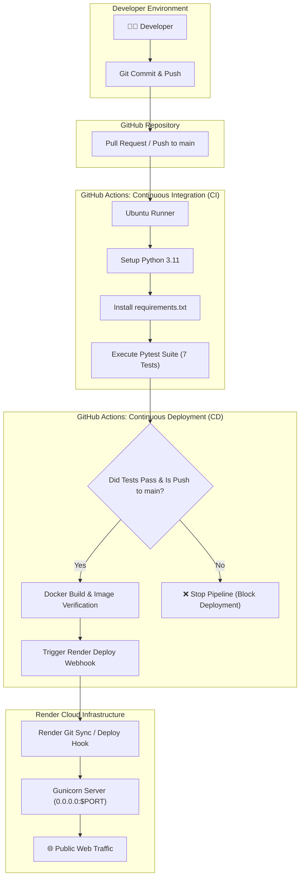

# AutoDeploy 🚀
### Automated CI/CD Pipeline with GitHub Actions, Docker & Render

[](https://github.com)
[](https://python.org)
[](https://flask.palletsprojects.com/)
[](https://docker.com)
[-brightgreen?logo=pytest)](https://pytest.org)
[](https://render.com)

---

## 1. Project Overview

**AutoDeploy** is an end-to-end DevOps demonstration project built to illustrate how modern software engineering teams design, automate, and monitor continuous integration and continuous deployment (CI/CD) pipelines. 

At its core, AutoDeploy features a lightweight Python/Flask web application backed by a production WSGI server (`Gunicorn`). Every code modification submitted to the repository triggers an automated pipeline via **GitHub Actions** that lints, verifies dependencies, runs unit tests using **Pytest**, validates reproducible container builds via **Docker**, and deploys live updates to **Render Cloud**.

This repository is structured to serve as an industry-standard blueprint suitable for software engineering and DevOps interviews, university demonstrations, and portfolio showcases.

---

## 2. Project Objectives

- **Automate Quality Assurance**: Prevent regressions and broken code from ever reaching production by enforcing automated unit tests on every pull request and push.
- **Ensure Environment Parity**: Eliminate "it works on my machine" issues by containerizing the application using standard multi-stage/minimal Docker practices.
- **Zero-Touch Deployment**: Automate cloud deployment directly to Render using secure GitHub Actions triggers upon successful merge into the `main` branch.
- **Security-First Best Practices**: Enforce non-root container users, isolated secret management via GitHub Secrets, clean `.dockerignore` filters, and defense-in-depth design.
- **Interview-Ready Architecture**: Provide clear mental models, visual diagrams, and verbal breakdowns explaining modern CI/CD principles.

---

## 3. Technology Stack

| Technology | Responsibility | Rationale |
|---|---|---|
| **Python 3.11** | Core Programming Language | High stability, extensive ecosystem, robust standard library. |
| **Flask 3.1** | Web Framework | Lightweight, clean routing, easy integration with WSGI servers. |
| **Gunicorn 23.0** | Production WSGI HTTP Server | High-concurrency worker-thread model suitable for cloud runtime. |
| **Pytest 8.3** | Automated Testing Framework | Fast, expressive test suite using Flask's native test client. |
| **Docker** | Application Containerization | Ensures environment consistency across local, CI, and cloud environments. |
| **Git & GitHub** | Version Control & Collaboration | Branching workflows, PR review gates, and automated action triggers. |
| **GitHub Actions** | CI/CD Automation Orchestration | Native YAML workflows, hosted Ubuntu runners, zero infrastructure overhead. |
| **Render Cloud** | Production Application Hosting | Native Git-backed deployment, free-tier support, automatic HTTPS, health probes. |

---

## 4. Architecture Explanation

The AutoDeploy architecture connects local developer workstations, GitHub version control, automated runner environments, container engines, and cloud production infrastructure.



### Key Separation of Concerns
1. **Continuous Integration (CI)**: Focuses on **Code Quality and Verification**. Runs for both pull requests and direct commits. If any unit test fails, the pipeline halts immediately, preventing faulty code from progressing.
2. **Continuous Deployment (CD)**: Focuses on **Release and Delivery**. Only triggers when code is merged into `main` **and** all CI tests pass. Builds the container image and dispatches a secure webhook to Render to update production traffic with zero manual intervention.

---

## 5. CI/CD Pipeline Workflow

The automated workflow is defined in `.github/workflows/ci-cd.yml` and consists of six distinct stages:

```mermaid
flowchart LR
    S1["1. Trigger<br/>(push / PR)"] --> S2["2. Checkout<br/>(actions/checkout@v4)"]
    S2 --> S3["3. Environment<br/>(setup-python@v5)"]
    S3 --> S4["4. Test<br/>(pytest -v)"]
    S4 --> S5["5. Containerize<br/>(docker build)"]
    S5 --> S6["6. Deploy<br/>(Render Webhook)"]

    style S1 fill:#1e293b,stroke:#38bdf8,stroke-width:2px,color:#f8fafc
    style S2 fill:#1e293b,stroke:#38bdf8,stroke-width:2px,color:#f8fafc
    style S3 fill:#1e293b,stroke:#38bdf8,stroke-width:2px,color:#f8fafc
    style S4 fill:#1e293b,stroke:#22c55e,stroke-width:2px,color:#f8fafc
    style S5 fill:#1e293b,stroke:#a855f7,stroke-width:2px,color:#f8fafc
    style S6 fill:#1e293b,stroke:#22c55e,stroke-width:2px,color:#f8fafc
```



### Stage Details

- **Stage 1: Trigger**: Monitored on pushes to `main` and all pull requests targeting `main`.
- **Stage 2: Checkout**: Downloads the repository workspace using `actions/checkout@v4`.
- **Stage 3: Python Environment**: Installs Python 3.11 with pip caching to accelerate subsequent runs. Installs runtime and testing dependencies (`Flask`, `gunicorn`, `pytest`).
- **Stage 4: Automated Testing**: Executes `pytest -v --tb=short`. Evaluates status codes, JSON response schemas, HTML output, and 404 handlers. A single test failure causes the entire workflow to exit with code 1.
- **Stage 5: Docker Build**: Executes exclusively on `push` to `main` after CI passes. Configures Docker Buildx (`docker/setup-buildx-action@v3`) and verifies that the Dockerfile builds cleanly without root privileges.
- **Stage 6: Deployment**: Sends an authenticated HTTP POST request to Render's Deploy Hook URL stored in repository secrets (`RENDER_DEPLOY_HOOK_URL`). If not configured, it issues a helpful notice without breaking the build.

---

## 6. Project Directory Structure

```
AutoDeploy/
│
├── app.py                  # Core Flask web application & API routes
├── requirements.txt        # Production & testing Python dependencies
├── Dockerfile              # Multi-step, secure non-root Docker build recipe
├── .dockerignore           # Excluded files during container build
├── render.yaml             # Render Blueprint infrastructure-as-code configuration
├── .gitignore              # Git ignore rules for virtual environments & caches
├── README.md               # Comprehensive project documentation
├── INTERVIEW.md            # Technical interview preparation guide
│
├── tests/
│   ├── __init__.py         # Package marker for test discovery
│   └── test_app.py         # Automated test cases using Flask test client
│
└── .github/
    └── workflows/
        └── ci-cd.yml       # Complete GitHub Actions CI/CD pipeline definition
```

---

## 7. Local Installation Instructions

Follow these steps to run the application locally on your workstation:

### Prerequisites
- Python 3.10+ installed
- Git installed
- Docker (optional, for container execution)

### Step 1: Clone the Repository
```bash
git clone https://github.com/<your-username>/AutoDeploy.git
cd AutoDeploy
```

### Step 2: Create and Activate a Virtual Environment
```bash
# On Linux / macOS
python3 -m venv venv
source venv/bin/activate

# On Windows (Command Prompt)
python -m venv venv
venv\Scripts\activate

# On Windows (PowerShell)
python -m venv venv
.\venv\Scripts\Activate.ps1
```

### Step 3: Install Dependencies
```bash
pip install --upgrade pip
pip install -r requirements.txt
```

### Step 4: Run the Development Server
```bash
python app.py
```
Open your browser and navigate to:
- **Homepage**: `http://localhost:5000`
- **Health Check**: `http://localhost:5000/health`
- **Info API**: `http://localhost:5000/api/info`

### Step 5: Run with Production WSGI Server (Gunicorn)
```bash
# On Linux / macOS / WSL
gunicorn --bind 0.0.0.0:5000 app:app

# Test dynamic port binding
PORT=8000 gunicorn --bind 0.0.0.0:8000 app:app
```

---

## 8. How to Run Automated Tests

The project includes unit tests organized in `tests/test_app.py`. They run via Flask's native test client without requiring a running web server.

### Execute Test Suite
```bash
pytest -v
```

### Expected Output
```text
============================= test session starts =============================
platform win32 -- Python 3.14.x, pytest-9.x.x
rootdir: /path/to/AutoDeploy
collected 7 items

tests/test_app.py::test_homepage_status_code PASSED                      [ 14%]
tests/test_app.py::test_homepage_contains_app_name PASSED                [ 28%]
tests/test_app.py::test_homepage_contains_running_status PASSED          [ 42%]
tests/test_app.py::test_health_endpoint_status_code PASSED               [ 57%]
tests/test_app.py::test_health_endpoint_expected_json PASSED             [ 71%]
tests/test_app.py::test_api_info_endpoint_valid_json PASSED              [ 85%]
tests/test_app.py::test_404_not_found PASSED                             [100%]

============================== 7 passed in 0.34s ==============================
```

---

## 9. How to Build and Run Docker

The provided `Dockerfile` leverages `python:3.11-slim`, drops privileges to a dedicated non-root user `appuser`, and runs `Gunicorn`.

### Step 1: Build the Docker Image
```bash
docker build -t autodeploy .
```

### Step 2: Run the Docker Container
```bash
docker run -d --name autodeploy-app -p 5000:5000 autodeploy
```

### Step 3: Verify the Running Container
```bash
# Check container status
docker ps

# Verify health endpoint
curl http://localhost:5000/health

# View real-time container logs
docker logs -f autodeploy-app
```

### Step 4: Stop and Remove Container
```bash
docker stop autodeploy-app
docker rm autodeploy-app
```

---

## 10. GitHub Actions Configuration

The pipeline script `.github/workflows/ci-cd.yml` enforces two jobs:

1. **`continuous-integration`**:
   - Runs on `ubuntu-latest` for pushes and pull requests.
   - Installs dependencies and runs `pytest -v --tb=short`.
   - Protects against merge errors.
2. **`continuous-deployment`**:
   - Condition: `if: github.ref == 'refs/heads/main' && github.event_name == 'push'`
   - Runs only after `continuous-integration` succeeds.
   - Re-builds and validates the Docker image.
   - Triggers deployment via Render Deploy Hook.

---

## 11. Render Deployment Instructions

Render offers a generous free tier for web services. You can deploy AutoDeploy using either of two methods:

### Method A: Blueprint Deployment (Recommended)
1. Fork or push this repository to your personal GitHub account.
2. Log in to [Render Dashboard](https://dashboard.render.com).
3. Click **New +** and select **Blueprint**.
4. Connect your GitHub repository.
5. Render detects `render.yaml` automatically and configures:
   - Environment: `Python 3.11`
   - Build Command: `pip install -r requirements.txt`
   - Start Command: `gunicorn --bind 0.0.0.0:$PORT app:app`
   - Health Check Path: `/health`
6. Click **Apply**. Your application will be live in ~2 minutes with a free `.onrender.com` SSL URL.

### Method B: Manual Web Service with Deploy Hook
1. In Render, select **New +** > **Web Service**.
2. Select your repository.
3. Configure the runtime as **Python 3**, set Build Command to `pip install -r requirements.txt`, and Start Command to `gunicorn --bind 0.0.0.0:$PORT app:app`.
4. Under **Settings** > **Deploy Hook**, copy the unique URL (e.g., `https://api.render.com/deploy/srv-xxxx?key=yyyy`).
5. Open your GitHub Repository > **Settings** > **Secrets and variables** > **Actions**.
6. Create a New Repository Secret:
   - Name: `RENDER_DEPLOY_HOOK_URL`
   - Value: `<Pasted Deploy Hook URL>`
7. Now, every push to `main` that passes testing will automatically trigger Render to deploy the new revision!

---

## 12. Environment Variables & Secrets

| Variable / Secret | Scope | Purpose | Default |
|---|---|---|---|
| `PORT` | Local / Container / Render | HTTP port the application binds to. | `5000` |
| `FLASK_ENV` | Application | Application runtime environment identifier. | `production` |
| `RENDER_DEPLOY_HOOK_URL` | GitHub Repository Secret | Secret webhook URL to trigger automated Render redeploys. | *None (User Configured)* |

> 🔒 **Security Notice**: Never commit API keys, webhook URLs, or credentials to version control. Always use GitHub Secrets and Render Environment settings.

---

## 13. Screenshots Section

*(When preparing your interview or portfolio demo, add captured screenshots here)*

- **Homepage UI**: Clean responsive dashboard with live status pill and architecture overview.
- **Terminal - Pytest Execution**: Output of `pytest -v` passing all 7 test cases.
- **Terminal - Docker Build**: Output of `docker build` and running container on port 5000.
- **GitHub Actions Tab**: Green checkmark showing passing CI and CD stages on push to `main`.
- **Render Dashboard**: Live service overview showing healthy status and public URL.

---

## 14. Future Improvements

1. **Docker Container Registry Push**: Integrate with GitHub Packages (GHCR) or Docker Hub to push versioned image tags (`sha`, `v1.0.0`).
2. **Static Code Analysis & Linting**: Integrate `Ruff` or `Flake8` for PEP 8 styling and `Bandit` for automated AST security analysis.
3. **Staging & Production Environments**: Deploy pull requests to ephemeral preview environments before promoting to production.
4. **Automated Rollback Verification**: Implement post-deployment smoke test jobs in GitHub Actions that automatically roll back if `/health` returns an error.
